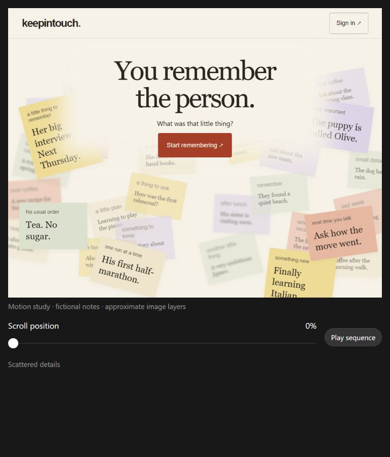
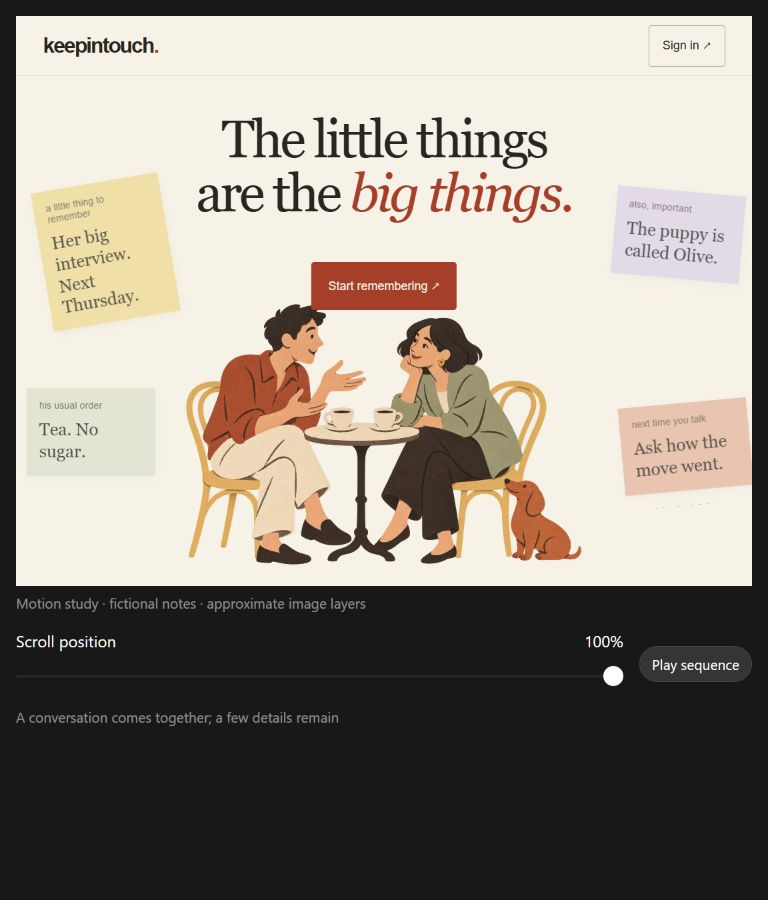

# A field of memories becomes a conversation

Status: concept proposal and motion study only. No application routes, styles, authentication, or current artwork have been changed.

## Protected baseline

- Approved design: `codex/keepintouch-landing`, pushed to `origin` through `597fc9e`.
- The implementation is commit `526bf59`; the separate startup-guidance commit is `597fc9e`.
- This exploration lives on `codex/landing-memory-prologue`, branched from that saved baseline. Do not merge or replace the approved design as part of the concept review.

## User request

- Explore approximately 30 apparently randomly placed notes at entry, including blurred and partially covered background fragments.
- On natural downward scroll, a man arrives from the left, a woman from the right, and the table from below; they assemble into the existing conversation scene.
- Reveal the approved headline, "The little things are the big things."
- Let notes move away, fade, blur, or recede as a metaphor for forgetting.
- Add 3-5 more cards about the people.
- Preserve the existing "A little note. A lot to come back to." sequence.
- Remove the two opening footnotes: "A little scene, imagined." and "A thoughtful place for what matters / between conversations."
- Plan and demonstrate the idea in theory before implementation.

## Interpretation and recommendation

Use **a field of memories becoming a conversation** as the new opening. The man and woman glide into place; avoid literal cycling/riding unless separately requested. This interpretation follows the proposed directional arrivals.

The composition should feel scattered while remaining art-directed. Use deterministic, responsive positions so the notes do not change unpredictably between page loads or cover navigation. Keep the logo, sign-in, a short product explanation, and a direct action available from the first frame.

Recommendation: let most incidental fragments recede, while four meaningful notes remain near the resolved scene. That makes the disappearance a metaphor for details slipping away, and the remaining notes explain what KeepInTouch helps hold onto. This is an agent proposal, not an additional user choice. Letting every detail disappear could imply that forgetting is the desired outcome.

Working assumption for "3-5 more cards": four additional fictional personal-detail notes in the collage, rather than four new feature/marketing sections. Do not treat that interpretation as confirmed. Proposed additions: "Tea. No sugar.", "His first half-marathon.", "Ask how the move went.", and "Finally learning Italian." Keep the interview/Olive notes already established. Illustrative details must not imply a new product feature or customer result.

## Proposed choreography

Percentages are initial art-direction proposals, to be tuned by observing the real scroll sequence.

| Scroll progress | Visible state                                                                                                                                                                  | Purpose                                                                    |
| --------------- | ------------------------------------------------------------------------------------------------------------------------------------------------------------------------------ | -------------------------------------------------------------------------- |
| 0-15%           | A field of 30 fragments; about six are readable foreground notes. Others are partly covered or softly out of focus. A brief opening line asks what little detail slipped away. | Establish recognition before the product explanation.                      |
| 15-45%          | Incidental notes drift outward and recede at different rates. Some fade or soften; their positions remain deterministic.                                                       | Show the fragility of memory without making an unreadable wall of content. |
| 35-75%          | The man arrives from the left, the woman from the right, and the table rises from below. Stagger their arrival slightly. Four key details settle at the margins.               | Redirect attention from fragments to the people and their conversation.    |
| 70-90%          | The three art layers settle, the approved headline becomes dominant, and the primary action stays clear.                                                                       | Resolve into the approved visual identity.                                 |
| 90-100%         | Hold a composed, readable hero briefly; release into normal page flow. The existing little-note sequence remains the next explanatory chapter.                                 | Give the resolved scene a moment without trapping the visitor.             |

Aim for approximately one ordinary viewport of scroll to resolve the opening on desktop, and a shorter version on phones. Do not intercept wheel/touch, alter scroll speed, require finishing the animation, autoplay an endless loop, or hide sign-in until completion.

## Materials and feasibility

- The original `public/landing/friends-v1.webp` is a single flattened cutout. It is not a ready-made three-layer scene.
- The theoretical motion study can reuse that artwork with approximate clipping to show the entrances. Those temporary geometric separations are not production assets and do not prove clean independent silhouettes.
- For implementation, prepare three matching transparent layers: man plus chair, woman plus chair/dog, and table plus cups. Separate hands/cups further only if overlap requires it. Use image-generation/editing tools with the approved illustration as reference; do not redraw or replace the admired illustration casually.
- Check perspective, relative scale, grain, palette, contact points, and occlusion in the assembled state. A clean final scene is more important than a large entrance distance.
- Keep approximately six foreground notes and about 24 background fragments. The background is atmosphere, not a claim that visitors must read 30 cards.
- Apply static blur to selected background layers; animate transforms and opacity. Avoid animating expensive blur filters across 30 large layers every frame. Clip fragments to the decorative scene, never to essential copy.
- Keep all illustration and notes within the existing warm paper/ink/rust/sage/butter/lilac language. No photos, stock imagery, external font service, or new product integrations.

## Responsive and accessible versions

- Phones: reduce visible foreground density and entrance distances; let some of the 30 fragments sit outside the crop. Do not shrink readable notes below a useful size or let the illustration cover the headline/action.
- Reduced motion: render the assembled conversation, approved headline, and a few meaningful notes immediately in normal flow. No long sticky opening is required.
- Keep decorative notes hidden from assistive technology with a concise equivalent description. Keep the meaningful copy, navigation, and real action as semantic HTML.
- Remove the two requested opening footnotes in the experimental implementation. The existing fictional-note label beside the process animation remains useful and was not requested for removal. No invented customer proof is introduced.

## Implementation sequence if the concept is selected

1. Create and visually check the separated illustration layers against the protected baseline.
2. Build an isolated opening sequence on this branch, keeping the current little-note sequence and lower page intact.
3. Add four proposed foreground notes and the decorative field; remove the specified footnotes.
4. Observe entry, assembly, resolved state, release, reverse scroll, and faster scroll. Tune timing and spacing from actual browser behavior.
5. Verify desktop, phone, 320px width, reduced motion, focus, navigation, and no horizontal overflow. Check the boundary between the new opening and existing sequence to avoid two exhausting introductions.
6. Run the existing required checks and capture corresponding states. Compare with the approved design before any merge.

## Acceptance criteria for the future implementation

- The existing design remains available on its pushed branch.
- Entry gives a clear product/relationship cue while presenting the note field.
- The three illustration elements visibly arrive from the requested directions and form a clean scene.
- The approved headline and sign-in remain readable and accessible.
- Additional notes enrich the people story without becoming feature cards.
- Requested footnotes are removed; the existing little-note animation remains recognizable.
- Reverse scroll retraces the sequence; scrolling remains natural; mobile and reduced motion preserve meaning.

## Concept-study limits

The companion study previews spatial relationships, departures, arrival order, and the headline handoff with a scrubber. It is not a shipped landing page, a performance benchmark, or evidence that the original image already contains separate production-ready layers. The live application remains the approved design throughout this planning step.

## Study source and observed checks

- `motion-study.fragment.html` preserves the self-contained in-conversation study source, including the existing illustration embedded as image data. It is not an application route or a standalone exported website. Render it with the visualize skill's preview helper when reviewing outside the conversation.
- Source is approximately 306 KB, below the inline-size limit. Inline script syntax was checked and the illustration marker resolved.
- Viewed the opening, intermediate assembly, and resolved scene at 736px width in the built-in browser. Fixed overlapping headline crossfades and moved the illustration below the action.
- Viewed entry and the resolved state at 320px width. Counted 30 note elements; the study's outer content width equaled its 320px client width, so the controls did not create horizontal overflow. Decorative scene cropping is intentional.
- Scrubbed forward to 60% and 100%, and backward to 0%; the scene and phase label changed accordingly. Playback was also exercised. These checks validate the motion study, not a future production scroll implementation.
- The current application implementation, build, approved artwork file, and existing little-note sequence were not modified. No application test rerun is required for this documentation-only exploration; production QA remains part of the future implementation plan above.

### Captured states

Opening and resolved frames are saved for review alongside the source. They show the theory study, not changes to the application.

