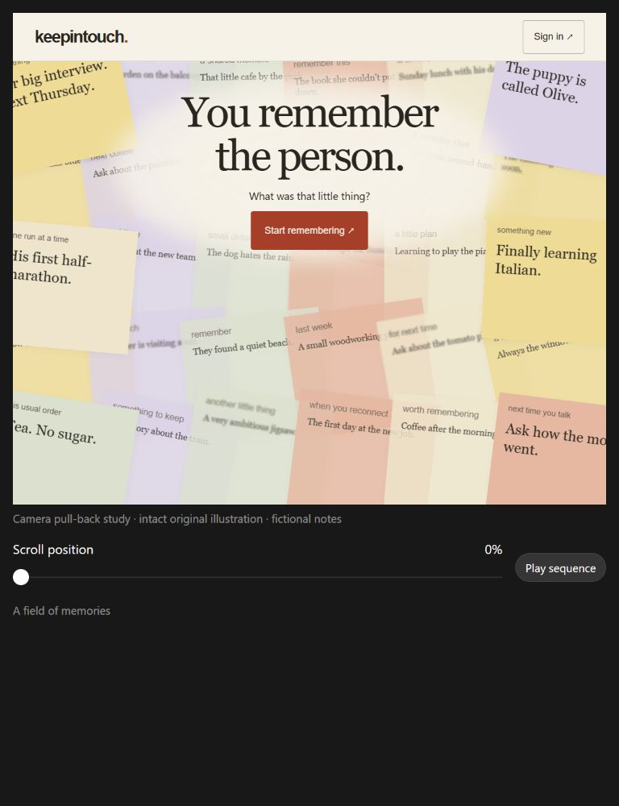
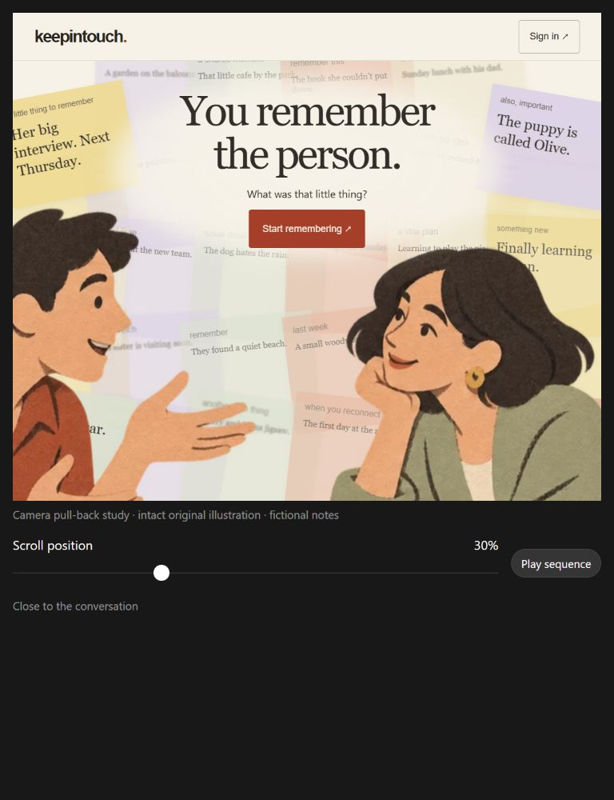
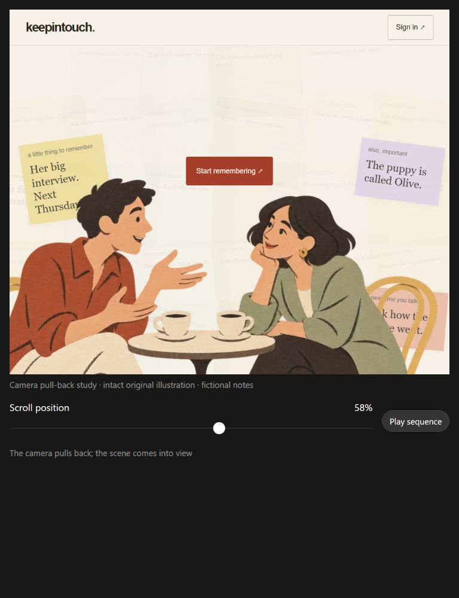
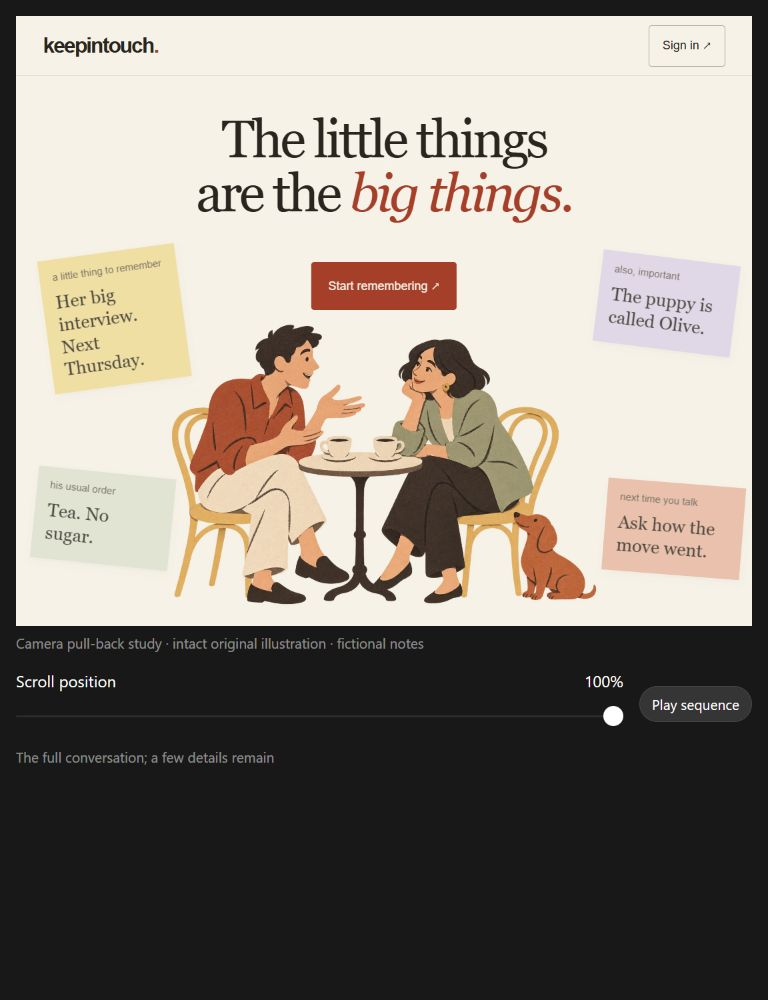
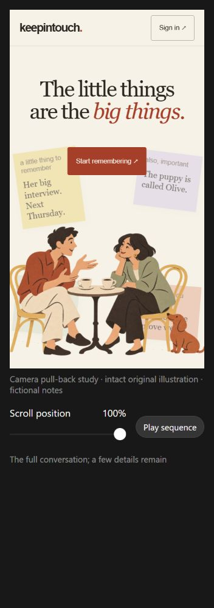

# Camera pull-back: revision 2

Status: revised theory study on `codex/landing-memory-prologue`. No application source, current production build, or approved illustration has been changed.

## Feedback incorporated

- Preserve the admired note-card language, but organize all 30 sheets into an overlapping field rather than leaving large gaps.
- Make the opening text's pale reading area smaller, with smooth edges rather than the visible left/right boundary of a blurred rectangle.
- Keep the user's selected **Soft dissolve** departure treatment.
- Replace the rough figure/table cuts.
- Start very close to the people at the edges and pull the view backward as scrolling progresses, so the scene becomes smaller and resolves into the approved composition.
- Keep Photoshop preparation available as an option for precise independent layers.

## Camera direction

This is a **camera pull-back effect**, often called 2.5D: a flat illustrated scene is projected through perspective and recedes along the depth axis. The notes form a separate plane. It gives the impression of moving from inside the conversation to its wider context, without inventing a new viewpoint behind the characters.

The people begin oversized and partially beyond the left/right edges. As the view recedes, their bodies, the table below, and the wider scene become visible. The approved headline settles above the completed conversation. Sign-in and the direct action stay available throughout.

The study's desktop close-up starts at approximately 3.6 times its resolved scale; the actual 30% state measured about 3.39 times the final image width. Phones use a smaller, responsive depth range so the characters can remain recognizable within a narrow crop. The "Close-up scale" design control can change the strength.

## Clean artwork without new generation

The first study used approximate geometric masks to simulate separate arrivals. They visibly sliced through the artwork. Revision 2 removes those masks entirely and moves the **intact original illustration** as one continuous plane.

This preserves the original faces, texture, silhouette, hands, table, and palette exactly and avoids seams or newly generated variations. No new image-generation call was needed for this revision.

The limitation is deliberate: the characters and table maintain their original relationships. Their emergence from the sides/bottom follows the shared camera projection; it is not separately timed motion of three independent assets. A true orbit around the scene or a view of the characters' backs would require new artwork or a 3D scene.

## Notes and reading area

- Still 30 note elements. Desktop uses six columns/five rows; narrow screens use five columns/six rows.
- Each sheet overlaps neighboring cells, with deterministic small offsets and rotations. The design looks scattered but is stable across renders.
- Four meaningful foreground notes remain near the resolved scene. Other sheets recede with the selected soft dissolve.
- The reading area is a smaller oval radial fade with fully transparent outer stops. It replaces the old wide, blurred solid rectangle. A restrained local text shadow helps the words remain readable over the denser material.
- The reading fade clears as the camera reveals the conversation, so there is no pale rectangle left across the resolved illustration.

## Proposed sequence

| Progress | Visible state                                                                                                                        |
| -------- | ------------------------------------------------------------------------------------------------------------------------------------ |
| 0-16%    | Dense field of notes; recognizable opening line and immediate action.                                                                |
| 12-35%   | Oversized people become visible at the edges, with the table largely below the crop.                                                 |
| 18-87%   | The shared camera pulls back; the full scene progressively comes into view while incidental notes dissolve.                          |
| 66-86%   | The approved headline becomes dominant above the receding scene.                                                                     |
| 87-100%  | Complete conversation, four selected details, and a clear action; release into the existing next chapter in a future implementation. |

The percentages and perspective values are art-direction proposals, not finalized production scroll durations. The current control represents scroll progress in a theory study.

## Optional Photoshop handoff

No Photoshop exports are necessary to review or implement this continuous pull-back. For stronger independent parallax or separately timed arrivals later, a layered PSD or three transparent PNGs would be useful:

1. **Man and chair**, including the full limbs/silhouette needed during movement.
2. **Woman, chair, and dog**, or a separate dog layer if independent movement is wanted.
3. **Table and cups**, with clean edge/leg continuity.

Use the same full canvas size and original positions for every layer; do not tightly crop each export. The project WebP is 1200 × 800. If using the original generated PNG at 1536 × 1024, keep that size consistently for every layer instead. Include a flattened reference to check the assembled result.

Preserve natural paper-edge texture and alpha transparency, remove stray pixels/halos, and reconstruct any surfaces that were hidden behind another object if their independent movement will expose them. Separate hands or cups further only where occlusion makes that necessary. Manual separation is the more reliable path for pixel-exact preservation; no price or time estimate is claimed.

## Actual checks and evidence

- Inline script syntax checked; self-contained source is under 1 MB.
- The browser confirmed one intact artwork image, zero clip masks, and 30 note elements.
- Viewed entry, a 30% close-up, 58% pull-back, and the resolved scene at 736px study width. The close-up image width measured approximately 1458px versus its 430px resolved width, confirming an actual perspective projection rather than a caption-only change.
- Viewed the opening, close-up, and resolution at 320px width. Outer content width equaled its 320px client width, so the controls did not create horizontal overflow. Decorative image/note cropping inside the scene is intentional.
- Checked forward and reverse scrubbing, visible phase changes, and playback. The study restores the selected departure and provides a close-up strength control.
- Reduced-motion guards resolve directly to the completed composition and make Play skip to the end. These guards were inspected in source; this revision does not claim verified operating-system media behavior inside the sandboxed preview frame.
- No application test suite was rerun: only this planning study and its documentation changed. Production scroll, performance, accessibility, and login regression checks remain required when implementing the chosen opening in the actual application.

Source: `motion-study-depth.fragment.html`. The prior `motion-study.fragment.html` is retained for comparison.

### Recorded states

