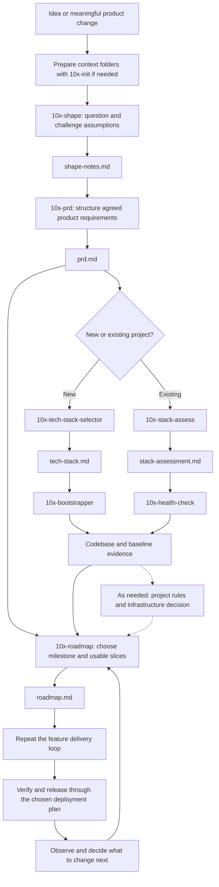
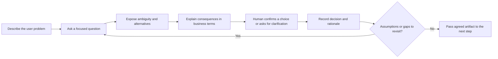
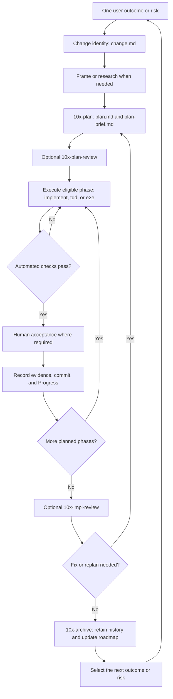

# What 10xDEVS gave me: a workflow I could follow, inspect, and learn from

This is an expanded research and idea bank for [the speaker structure](tech-talk-speaker-structure.md). It adds a substantive course sneak peek alongside the personal story. It is deliberately not fitted into the earlier 35-minute speaking budget. Select and compress the material after reviewing it.

The research inspected all **23 installed 10x skill definitions**, selected references, and concrete KeepInTouch documents. The local manifest reports @przeprogramowani/10x-cli version 1.20.0 and lesson installations across the course. This describes that installed snapshot, not a fresh review of every lesson or the latest public syllabus. The tracked-code reference above identifies the inspected checkout; these presentation notes are working documents.

Three evidence levels are kept separate:

- **Explicit design:** what the installed skill instructions tell an agent to do.
- **Project evidence:** documents, source, and dated records showing what happened in KeepInTouch.
- **Interpretation for the talk:** why this was useful to the speaker and what colleagues might try.

The skill definitions were studied as source material. They were not invoked to reshape the product, deploy anything, or modify archived changes. No new test run, dependency audit, or hosted-state verification is claimed.

## 1. The central explanation for the audience

> “The course gave me a route through work I knew existed but had never carried out myself. Each stage had a purpose, expected inputs, and an output the next stage could use.”

That is the clearest explanation of the approach. It packages product and engineering questions into reusable workflows. It also makes unfinished decisions, assumptions, and verification steps easier to see.

The metaphor of an artifact being “food for the next skill” is useful. Prefer this more precise formulation when presenting:

> “The next step starts from what we have already agreed and recorded, instead of reconstructing the whole project from a conversation.”

Not every skill writes a new Markdown document. Implementation produces code, tests, evidence, and progress updates. Archiving moves an existing folder. Rule review normally prints a scorecard. The general pattern is a reviewable output and a known next consumer, not a compulsory new file after every action.

The other personal message remains:

> “Building gave me an understanding that tutorials and discussions hadn't made real for me. The workflow helped me keep going once I started.”

Source: [discovery stance](../../.agents/skills/10x-shape/SKILL.md), especially lines 14–18 and 205–220; [planning's upstream-artifact rules](../../.agents/skills/10x-plan/SKILL.md), lines 29–74.

## 2. A golden path through a new or existing project

This is a presentation synthesis of documented routes, not a mandatory sequence of all 23 commands or a one-click automation.



Standalone diagram: [golden path](tech-talk-10x-golden-path.mmd).

Read the route in plain language:

1. **Prepare a place for project knowledge.** Establish the context folders if needed.
2. **Shape the problem.** Who needs what, why now, what is the smallest useful flow, and what could make the idea wrong?
3. **Record product requirements.** Structure agreed decisions without quietly inventing the missing ones.
4. **Choose the appropriate technical route.** Select and scaffold a new project, or assess an existing stack and project condition.
5. **Make environment and working conventions explicit.** Record hosting choices, repository rules, and applicable constraints.
6. **Choose a small delivery outcome.** Break a milestone into usable end-to-end slices.
7. **Deliver one change at a time.** Research, plan, implement, verify, and review as needed.
8. **Release through an explicit deployment plan.** Check the relevant environment and decide what should happen next.

The greenfield/brownfield distinction is important for company colleagues. The course does not only start empty repositories: its existing-system route asks what is already there, what changes, and what must be preserved.

Some arrows describe the recommended teaching sequence rather than hard prerequisites. PRD generation can accept raw notes; roadmap planning can accept other source material; stack assessment and health checking can run independently. Stack selection and bootstrapper have stronger artifact prerequisites. Support work such as agent onboarding and infrastructure research need not happen in one universal order.

There is no installed dedicated “deploy everything” skill in this 23-skill set. Infrastructure research informs a deployment plan, and prompts/implementation carry that plan into actual configuration and release work. KeepInTouch's current CI file and historical deployment records are project evidence, not proof that bootstrapper generates a complete delivery pipeline.

Sources: [shape routing](../../.agents/skills/10x-shape/SKILL.md), lines 14–33; [bootstrapper](../../.agents/skills/10x-bootstrapper/SKILL.md), lines 18 and 196–205; [roadmap](../../.agents/skills/10x-roadmap/SKILL.md), lines 43–49 and 82–127; [deployment prompt](../../.agents/prompts/m1l5-1-plan-integration.md); [historical deployment plan](../deployment/deploy-plan.md).

## 3. Loop one: questions become decisions, then reusable context



Standalone diagram: [decision loop](tech-talk-10x-decision-loop.mmd).

The installed discovery skill is unusually explicit about being a facilitator rather than a generator of product decisions. Its repeated pattern is: open a phase, elicit the user's answer, identify ambiguity, offer positions with trade-offs, confirm the decision, and write it into shaping notes with a checkpoint.

The dedicated Socratic round challenges every captured functional requirement. It asks what would make the requirement wrong or harmful, and records the response underneath the requirement. The purpose is to question inclusion and meaning before implementation makes them expensive to change.

Good source-backed questions to show:

| Moment                | Question or task in the installed skill                                                         | Why it matters to a PM                                               |
| --------------------- | ----------------------------------------------------------------------------------------------- | -------------------------------------------------------------------- |
| Problem               | Who has the pain, when do they feel it, and what does it cost today?                            | Names a situation and user rather than a vague application category. |
| Access                | How does the person get into the app, and are there different roles?                            | Introduces access boundaries before designing screens.               |
| Scope                 | Sketch the smallest end-to-end flow that would prove value.                                     | Defines a finishable experiment.                                     |
| Requirement challenge | What is the strongest counter-argument to including this capability?                            | Makes scope decisions deliberate.                                    |
| Business rule         | What rule distinguishes the product from a record list?                                         | Asks what meaningful behavior the application adds.                  |
| Quality               | What externally observable property must hold, such as response timing or a privacy commitment? | Turns an aspiration into something that can later be checked.        |
| Scale                 | Roughly how many people will use it, and what changes at a much larger scale?                   | Makes expected use an explicit input rather than an assumption.      |
| Non-goals             | What are we explicitly not doing in this version?                                               | Helps prevent discarded scope silently returning.                    |
| Existing system       | What is changing, and what must not break?                                                      | Preserves users, contracts, and data while modifying a real system.  |

These are paraphrases of documented prompts unless quotation marks identify exact short wording. They are not a reconstructed transcript of the speaker's original sessions.

One worthwhile critique: the skill strongly challenges “empty CRUD.” That can help a learner articulate value, but a simple record-management tool can still solve a real problem. Present the challenge as a teaching stance, not proof that every useful application needs sophisticated logic.

Sources: [10x-shape](../../.agents/skills/10x-shape/SKILL.md), lines 223–308, 310–385, 429–455, 457–515, and 517–628.

## 4. When a technical question exceeds my knowledge

This was a learning mechanism in the speaker's experience: an unfamiliar question became a reason to understand the consequences, rather than blindly accept a recommendation or guess.

Suggested reusable response, not a historical quotation:

> “I don't know enough to choose yet. Explain why this decision matters, what the user would notice, and which business questions I can answer so you can recommend an option. Tell me the trade-off and what still needs expert review.”

Examples for presentation discussion:

| Technical framing                        | More accessible questions                                                                                       | Boundary                                                                                         |
| ---------------------------------------- | --------------------------------------------------------------------------------------------------------------- | ------------------------------------------------------------------------------------------------ |
| Local versus cloud storage               | Must the same information appear on another device? Is sharing required? What happens if browser data is lost?  | These answers influence persistence choices; they do not automatically choose a database engine. |
| Authentication and roles                 | Who should get in, and can different people see or change different things?                                     | Sign-in and authorization remain separate concerns.                                              |
| Simultaneous editing                     | If two people edit the same item, is an overwrite acceptable or must someone resolve the conflict?              | Connects a technical policy to lost work and user expectations.                                  |
| Deployment flow                          | Should a checked change go live automatically or wait for a promotion decision?                                 | Makes operational responsibility explicit.                                                       |
| Error handling                           | If AI extraction fails, should the last useful briefing remain, and what should the user see?                   | Gives implementation and tests a clear expected outcome.                                         |
| Relational versus non-relational storage | What information is linked, what questions must be answered across it, and which changes must succeed together? | Business answers help a technical recommendation; they do not replace architecture expertise.    |

The installed plan skill actually contains the simultaneous-editing example, with alternatives and strengths/trade-offs. The stack-selection interview contains recommended/default routes, deployment/CI questions, and an explicit “I don't know yet” option. The last database row is an illustrative translation aid, not evidence that the speaker was asked that exact question.

The intended division is informed human decisions supported by research and explanation. That does not mean the PM must personally select every implementation detail. Planning explicitly reserves details discoverable from established project patterns for the agent.

Sources: [plan questioning](../../.agents/skills/10x-plan/SKILL.md), lines 147–185 and 253–279; [stack interview](../../.agents/skills/10x-tech-stack-selector/references/residual-interview.md), lines 117–164 and 200–240.

## 5. The clearest artifact handoff to demonstrate

Use the stack-selection/bootstrapper pair because the producer and consumer both describe the contract.

**Producer: 10x-tech-stack-selector**

It reads the PRD, uses its product/scale/timeline information, confirms missing choices, and chooses among a curated starter registry. The documented criteria concern explicit types, conventions, ecosystem familiarity, and documentation. These are registry judgments, not runtime measurements of a model's training data or proof of code quality.

It writes a compact tech-stack.md: structured metadata plus one short rationale paragraph.

An abridged excerpt from the real KeepInTouch file:

```yaml
starter_id: 10x-astro-starter
package_manager: npm
project_name: keep-in-touch
hints:
  team_size: solo
  deployment_target: cloudflare-workers
  ci_provider: github-actions
```

This is an excerpt, not a complete standalone handoff conforming to every required field.

**Consumer: 10x-bootstrapper**

It requires the recorded handoff; conversation history cannot substitute. The starter identifier selects a registry card, its command creates the initial codebase, and the skill records verification evidence.

Why it is a good example: the next step does not need to repeat the entire framework debate to know which starter it should use.

Important limits:

- The consumer's procedure explicitly says deployment/CI hints are logged rather than automatically implemented in v1.
- Bootstrapper v1 does not create AGENTS.md or CI workflows.
- Some schema/criteria prose promises broader behavior than that consumer implements. Use the actual consumer procedure for the talk.
- The schema intentionally leaves rich rationale in the conversation while storing a short summary. The artifact therefore does not preserve every nuance automatically. Important additional reasoning may need its own durable decision note.
- Passing a versioned file requires the correct path; there is no universal automatic “use newest artifact” mechanism.

Sources: [stack selector](../../.agents/skills/10x-tech-stack-selector/SKILL.md), lines 32–79, 117–159, and 257–270; [handoff schema](../../.agents/skills/10x-tech-stack-selector/references/handoff-schema.md), lines 1–12 and 162–168; [consumer contract](../../.agents/skills/10x-bootstrapper/references/handoff-consumer.md), lines 15–67; [real handoff](tech-stack.md).

## 6. Loop two: deliver one outcome with evidence



Standalone diagram: [delivery loop](tech-talk-10x-delivery-loop.mmd).

This diagram shows a supported route, not an enforced state machine. The frame/research stage is optional and can run in the appropriate order or be omitted. A saved plan review is optional. A recorded outcome is not automatically an approved outcome.

The three execution choices share the plan and its Progress convention, but have different eligibility:

- **10x-implement:** build the planned change and run its checks.
- **10x-tdd:** test-first execution of behavior not yet implemented and suitable for that method.
- **10x-e2e:** browser-level checks against an already implemented, runnable feature and a risk that warrants browser coverage. It does not set up the entire testing stack. It also has a standalone single-risk mode.

In the documented phase loop, automated criteria are followed by required manual acceptance, a scoped commit, and recorded progress. A human should not be replaced by a fabricated manual checkmark.

The plan's Progress section is the shared resumption contract. The next pending row identifies the next step, and completed rows can carry a commit reference. A new session can recover this recorded state without reconstructing every prior message.

This is still incomplete memory. Active processes, touched-file sets, unresolved discussions, and other transient context can require a handover. The plan and code must also be checked for freshness.

At closure, implementation review compares completed work with the plan, architecture, boundaries, patterns, and success criteria. Findings can be fixed, deferred, or accepted as risk. Archive preserves the history and updates the matching roadmap item. Archiving does not run tests, certify acceptance, or push the branch.

Sources: [planning](../../.agents/skills/10x-plan/SKILL.md), lines 334–376 and 520–524; [implementation](../../.agents/skills/10x-implement/SKILL.md), lines 35–46, 118–230, and 254–296; [Progress contract](../../.agents/skills/10x-plan/references/progress-format.md), lines 36–69; [archive](../../.agents/skills/10x-archive/SKILL.md), lines 53–96 and 209–216; [E2E modes](../../.agents/skills/10x-e2e/SKILL.md), lines 7–36.

## 7. All 23 skills: what they contribute and hand off

This is a reference dictionary, not a slide to read aloud. Outputs shown are defaults; some skills support alternative/versioned paths. C below means context/changes/&lt;change-id&gt;/.

| Skill                                                                            | Main input                                             | Output                                                                | Next use                                                |
| -------------------------------------------------------------------------------- | ------------------------------------------------------ | --------------------------------------------------------------------- | ------------------------------------------------------- |
| [10x-init](../../.agents/skills/10x-init/SKILL.md)                               | Current folder state                                   | Missing context directories and READMEs                               | Shared home for artifacts                               |
| [10x-shape](../../.agents/skills/10x-shape/SKILL.md)                             | Idea/change, user answers, existing context            | foundation/shape-notes.md and checkpoints                             | PRD generation                                          |
| [10x-prd](../../.agents/skills/10x-prd/SKILL.md)                                 | Shaping notes or raw notes, canonical schema           | foundation/prd.md                                                     | Stack selection/assessment and roadmap                  |
| [10x-tech-stack-selector](../../.agents/skills/10x-tech-stack-selector/SKILL.md) | PRD, registry, remaining choices                       | foundation/tech-stack.md                                              | Bootstrapper                                            |
| [10x-bootstrapper](../../.agents/skills/10x-bootstrapper/SKILL.md)               | Recorded stack choice and starter card                 | Codebase and bootstrap-verification/verification.md                   | Baseline for implementation                             |
| [10x-stack-assess](../../.agents/skills/10x-stack-assess/SKILL.md)               | Existing codebase, criteria                            | foundation/stack-assessment.md                                        | Health-check context and compensation choices           |
| [10x-health-check](../../.agents/skills/10x-health-check/SKILL.md)               | Existing dependencies, commands, tests, CI             | foundation/health-check.md                                            | Human triage, onboarding, planned remediation           |
| [10x-infra-research](../../.agents/skills/10x-infra-research/SKILL.md)           | Constraints, interview, platform research              | foundation/infrastructure.md                                          | Explicit deployment/integration plan                    |
| [10x-agents-md](../../.agents/skills/10x-agents-md/SKILL.md)                     | Repository evidence and conventions                    | AGENTS.md or selected instruction file                                | Future agent work                                       |
| [10x-roadmap](../../.agents/skills/10x-roadmap/SKILL.md)                         | Product context and actual baseline                    | foundation/roadmap.md                                                 | Select the next usable slice                            |
| [10x-new](../../.agents/skills/10x-new/SKILL.md)                                 | Change identity and intent                             | C/change.md                                                           | Common identity for the change                          |
| [10x-frame](../../.agents/skills/10x-frame/SKILL.md)                             | Observation plus suspected cause/direction             | C/frame.md                                                            | Reframed/confirmed input to planning                    |
| [10x-research](../../.agents/skills/10x-research/SKILL.md)                       | Research question and live project                     | C/research.md                                                         | Evidence-grounded frame/plan                            |
| [10x-plan](../../.agents/skills/10x-plan/SKILL.md)                               | Task, source evidence, optional frame/research         | C/plan.md and C/plan-brief.md                                         | Execution and reviews                                   |
| [10x-plan-review](../../.agents/skills/10x-plan-review/SKILL.md)                 | Plan, brief, relevant project evidence                 | Findings; saved C/reviews/plan-review.md when selected                | Plan revision or execution decision                     |
| [10x-implement](../../.agents/skills/10x-implement/SKILL.md)                     | Approved plan, relevant code                           | Code, checks, commits, Progress/status updates                        | Manual acceptance and implementation review             |
| [10x-tdd](../../.agents/skills/10x-tdd/SKILL.md)                                 | Eligible unimplemented behavior in a plan              | Failing test, implementation, refactor, shared Progress               | Verified phase, same delivery loop                      |
| [10x-e2e](../../.agents/skills/10x-e2e/SKILL.md)                                 | Browser-level risk, runnable feature, test conventions | Reviewed browser test and failure verification; Progress in plan mode | Regression evidence and CI                              |
| [10x-test-plan](../../.agents/skills/10x-test-plan/SKILL.md)                     | Product context, project signals, user concerns        | foundation/test-plan.md                                               | Risk-based rollout through research/plan/implementation |
| [10x-impl-review](../../.agents/skills/10x-impl-review/SKILL.md)                 | Plan, completed work, evidence                         | C/reviews/impl-review.md or phase report                              | Triage, follow-up, closure                              |
| [10x-archive](../../.agents/skills/10x-archive/SKILL.md)                         | Change artifacts and Git state                         | Archived folder, lifecycle stamp, local commit                        | Historical evidence and roadmap status                  |
| [10x-rule-review](../../.agents/skills/10x-rule-review/SKILL.md)                 | Selected AI instruction file                           | Scorecard and prioritized suggestions, normally read-only             | Human-directed instruction improvement                  |
| [10x-lesson](../../.agents/skills/10x-lesson/SKILL.md)                           | Recurring problem and a confirmed rule                 | Appended foundation/lessons.md entry                                  | Priors for future research/planning/execution           |

No lessons.md was present in this checkout during inspection. Availability of that skill is not evidence it was used. Similarly, an archive folder is not evidence that every optional review/TDD step ran.

The diagrammed startup route emphasizes the main course chain. These supporting skills widen coverage without turning the course into one long compulsory checklist.

## 8. Testing is another handoff, not a test-count contest

A concise additional loop to explain verbally:

**Product risk → evidence needed → research the actual failure path → plan the cheapest useful checks → implement → challenge the checks → retain the pattern.**

10x-test-plan writes risk strategy and response intent, not test code or CI configuration. Its research handoff asks the next skill to locate the actual failure path rather than invent a code location. Planning then turns that evidence into implementation phases.

The skill warns about the oracle problem: an AI-written test can copy an expected result from the implementation and merely approve the same mistake. Requirements and independent contracts should determine expected behavior.

10x-e2e uses the sequence **plan → generate → review → verify**. Its notable proof step is to confirm that a targeted test fails when the defect is deliberately introduced, then restore the implementation and return to green.

KeepInTouch's recorded edit-persistence experiment is a clear illustration: the edited name appeared on screen, but the test failed after reload when persistence was bypassed. This is recorded September evidence, not a new live test result.

The actual CI file defines typecheck, lint, unit/integration tests, build, and browser tests. Configuration alone does not establish that the latest run passed or that branch protection enforces it. A hook configuration also needs to be supported and activated before it supplies feedback.

Sources: [test-plan principles](../../.agents/skills/10x-test-plan/SKILL.md), lines 49–55, 306–343, and 606–611; [browser eligibility and verification](../../.agents/skills/10x-e2e/SKILL.md), lines 117–132 and 214–237; [recorded persistence exercise](certification-evidence.md), lines 60–66; [CI configuration](../../.github/workflows/ci.yml); [hook configuration](../../.codex/hooks.json).

## 9. Real chain of artifacts: one KeepInTouch feature

Use “Don't suggest this subject again” as the recurring example because its meaning crosses product behavior, storage, privacy, model prompting, and verification.

| Stage            | Actual evidence                                   | What is handed forward                                                             |
| ---------------- | ------------------------------------------------- | ---------------------------------------------------------------------------------- |
| Shaping          | shape-notes.md, FR-006 and its Socratic challenge | The accepted distinction between exclusion intent and best-effort model compliance |
| PRD              | prd.md, FR-006 and preserved FR-011               | Required user behavior and unchanged privacy/auth boundaries                       |
| Roadmap          | S-03, exclusion-aware-core-topics                 | A delivery slice dependent on the existing Core Topics flow                        |
| Plan brief       | Key Decisions Made table                          | Why confirmation, minimal wording, and failure atomicity were selected             |
| Detailed plan    | Three phases and acceptance criteria              | Storage, extraction boundary, and UI/verification work                             |
| Execution record | Plan Progress, closing references to 6f8bcad      | Recorded work and manual/automated evidence                                        |
| Closure          | Archived change.md and retained folder            | Historical decisions and declared verification limits                              |

The exclusions folder contains plan, brief, and change records, but **no saved implementation-review report**. Do not draw one into its history. All three phase records reference the same implementation commit, so it also does not demonstrate a separate commit per phase.

For evidence of a saved review, use the separate public-production-entry change: its plan records three phase commits, its implementation review records an APPROVED verdict with a retained warning, and its change record is archived. This illustrates the review/triage branch without pretending every change followed every optional step.

An honest presentation can say: “Here is the workflow the skills describe, and here is the subset we can actually trace in this feature.”

Sources: [shaping decisions](shape-notes.md), lines 120–134; [requirements](prd.md), lines 89–103; [roadmap](roadmap.md), lines 40–46 and 98–108; [exclusion brief](../archive/2026-09-11-exclusion-aware-core-topics/plan-brief.md), lines 23–32; [exclusion plan](../archive/2026-09-11-exclusion-aware-core-topics/plan.md), lines 361–406; [archived change](../archive/2026-09-11-exclusion-aware-core-topics/change.md); [public-entry review](../archive/2026-09-12-public-production-entry/reviews/impl-review.md).

## 10. Ten lessons to present from the PM perspective

These are candidate arguments grounded in the installed workflow and the speaker's reflections. They are not ten additional mandatory presentation chapters.

1. **Begin with the user's problem, not a framework.** Discovery separates product intent from technology choices. The question is who experiences what problem and what outcome would help.
2. **A question can be useful before its answer is obvious.** Access, scope, failure behavior, and data boundaries were surfaced by the workflow rather than left for the PM to remember.
3. **Choose a finishable end-to-end result.** Roadmap slices target usable outcomes. A foundation exists to unlock a named capability, not to justify speculative architecture.
4. **A skill is reusable working guidance.** It specifies what to inspect, ask, produce, and check. It is more than a favorite prompt, but remains instructions that need competent execution.
5. **An artifact is a handoff and a memory aid.** The next step starts from recorded decisions. Humans and future sessions can recover the state without rereading an entire chat.
6. **Ask for consequences in language you understand.** AI explanations can translate unfamiliar options into user/business choices. Informed consent is different from pretending you have gained every relevant technical skill.
7. **Separate planning, execution, and checking without isolating them.** Different responsibilities create review opportunities; feedback can still change a plan or product.
8. **Preserve evidence, not only completion claims.** Plans distinguish automatic checks from manual acceptance, and commits give recorded work a traceable reference.
9. **Make the work resumable.** Shared Progress, current decisions, and a short handover support switching sessions. They do not guarantee that transient context or stale assumptions have been solved.
10. **Treat the workflow as a reusable asset across tools.** In the speaker's experience, having a route and understanding its steps mattered more than debating tool brands. Models, permissions, integrations, cost, and capability still affect whether a particular task can be done well.

Useful optional lines, not historical quotations:

> “The course made me consider questions I might not have known to ask.”

> “When I didn't understand a technical choice, I could ask what the user would notice and which business answers would help resolve it.”

> “The next skill didn't need my entire conversation. It needed the relevant decisions and the work it was supposed to continue.”

Keep the final line qualified by the context limits below.

## 11. What this protects against, and what it costs

Define the comparison as **ad hoc prompting for this project**, not a claim that everyone using the term vibe coding works identically.

| Dimension      | Ad hoc approach to contrast             | Structured approach in this toolkit                    | Cost or limitation                                               |
| -------------- | --------------------------------------- | ------------------------------------------------------ | ---------------------------------------------------------------- |
| Goal           | Start coding from an incomplete request | Shape the user outcome and challenge assumptions       | More upfront effort; discovery still needs real evidence         |
| Scope          | Add whatever sounds useful next         | State non-goals and choose a small slice               | Documents can freeze a poor assumption if never revisited        |
| Decisions      | Leave rationale in conversation         | Record key choices in appropriate artifacts            | Not all rationale is actually persisted by every skill           |
| Context        | Accumulate unrelated requests           | Reuse bounded artifacts and focused research           | Some stages still read whole documents; no measured token saving |
| Implementation | Chase a visible result                  | Execute phases with explicit criteria                  | Ceremony can be excessive for a tiny change                      |
| Verification   | Accept a plausible answer or screen     | Check requirements and deliberately challenge tests    | Passing checks cover their defined scope only                    |
| Continuity     | Re-explain where work stopped           | Use Progress, status, source references, and handovers | Stale files and wrong paths can carry errors forward             |
| Operations     | Finish when the app opens               | Plan repository, CI, hosting, release, and ownership   | The skills do not automatically configure or govern everything   |

Unstructured exploration can be useful for a quick sketch or learning exercise. The speaker's benefit came from a workflow suited to sustained delivery and an app with data, authentication, and external processing. It is not proof that every small task needs a PRD and multiple reviews.

The installed planning skill still defines several questions for LOW-complexity work, and there is no general tiny-change bypass across the delivery set. The speaker's small-color-change anecdote can make that overhead concrete. A direct small edit is a proportionate working choice, not a special documented 10x fast path discovered by this research.

Spec-driven development is a useful resemblance: intent and artifacts guide execution. The additional features visible here are the broader coverage of discovery, existing-system analysis, delivery, QA rollout, reviews, and historical closure. Those ideas are not exclusive to this course and do not establish superiority over other approaches.

## 12. Context economy: the claim to make carefully

There is real evidence of context-conscious design:

- Stack selection filters the starter registry before reading candidate cards.
- Planning reduces repeated questions when a frame or research document already supplies answers.
- The compact stack handoff and human plan brief avoid replaying every discussion.
- The plan includes advice to synthesize research summaries and reopen a saved draft in a fresh session.
- Progress gives multiple execution skills a shared record of where to resume.

But “the next skill receives only the minimum possible context” would overstate the implementation:

- Stack selection still explicitly reads the full PRD.
- Implementation reads the plan and referenced source fully.
- Planning contains both full-reading instructions and later advice against rereading subagent-analyzed material.
- The files can become long or outdated.
- Some choices remain only in conversation.
- No before/after token or context-efficiency measurement was performed here.

Suggested presentation wording:

> “The artifacts reduce the need to replay earlier conversations and help each stage find the decisions it needs. They don't eliminate context management.”

Sources: [selector](../../.agents/skills/10x-tech-stack-selector/SKILL.md), lines 79 and 132; [plan artifact reuse](../../.agents/skills/10x-plan/SKILL.md), lines 47–74; [plan context advice](../../.agents/skills/10x-plan/SKILL.md), lines 739–751; [implementation reading](../../.agents/skills/10x-implement/SKILL.md), lines 35–38.

## 13. What the workflow brings into view for a non-developer PM

| Concern                                 | Where it is surfaced                                                  | What is not guaranteed                                                  |
| --------------------------------------- | --------------------------------------------------------------------- | ----------------------------------------------------------------------- |
| User, problem, useful business behavior | Shaping and PRD                                                       | Product-market fit or evidence from real users                          |
| Scale, scope, and constraints           | Shaping, roadmap, planning                                            | Performance at untested load                                            |
| Authentication and roles                | Shaping, PRD, implementation/testing                                  | Correct production configuration merely because auth was discussed      |
| Data privacy and failure behavior       | Requirements, contracts, plans, tests                                 | A complete privacy or security assessment                               |
| Stack/architecture                      | Stack selection or assessment, research, plans/reviews                | Correctness of every recommendation                                     |
| Code history and collaboration          | Git-oriented implementation, reviews, archive; GitHub in this project | A pushed branch, backup, or repository policy merely from local commits |
| Automated checks                        | Test strategy, test execution, hooks, CI                              | Active hooks, successful current CI, or comprehensive coverage          |
| Deployment and operation                | Infrastructure decision, deployment prompts/plans, release work       | Automatic provisioning or ongoing ownership                             |
| Repeatability                           | Artifact contracts, Progress, rules, lessons                          | A deterministic lifecycle engine                                        |
| Learning                                | Questions, trade-offs, deliberate practice                            | Independent expertise in every technical discipline                     |

This is the most accurate explanation of feeling “hand-held”: the route surfaced categories of work and decisions the speaker might have overlooked. It did not remove the need to understand, challenge, or seek help with them.

## 14. Where instructions and enforcement differ

The inspected skill folders provide instructions and reference formats. The change-record reference explicitly says state transitions are not enforced. Labels such as “hard gate” tell the assistant what it should do; they are not themselves a filesystem lock, schema validator, or CI requirement.

KeepInTouch has executable checks in its CI workflow and hooks configuration, but those checks serve specified purposes. The CI file does not enforce the complete 10x lifecycle.

Other cautions from the source inspection:

- A review status is not the review verdict; a rejected or partial review can still be recorded as reviewed.
- Archive can warn on incomplete material and does not certify that every check passed.
- Historical documents can retain paths from before they were archived.
- PRD section counts and bootstrapper responsibilities contain inconsistent prose across source documents.
- Referenced helpers or future skills are not automatically part of the local installed toolkit.
- The current certification record and AGENTS.md reflect different toolkit states in some areas.
- README's audit requirement is not an audit step in the inspected CI file.

These are reasons for an honest, maintainable workflow rather than a reason to discard the approach. Keep most implementation inconsistencies in speaker preparation, not the main audience story.

Sources: [change-record semantics](../../.agents/skills/10x-new/references/change-md.md), lines 45–54; [implementation review status](../../.agents/skills/10x-impl-review/SKILL.md), lines 250–255; [canonical PRD schema](../../.agents/skills/10x-shape/references/prd-schema.md), lines 7–12; [bootstrap consumer](../../.agents/skills/10x-bootstrapper/references/handoff-consumer.md), lines 52–63; [CI](../../.github/workflows/ci.yml).

## 15. How this enriches the eventual talk

Keep the changed-way-of-working direction, the learning invitation, the two purposes of building, and the community's capability-versus-judgment challenge.

This module adds a genuine course sneak peek:

- One map of the overall route.
- One question-to-decision example.
- One concrete artifact handoff.
- One repeated feature-delivery loop.
- A selection of the ten PM lessons.
- One real chain from the project and its limitations.

A useful audience exercise is to give a familiar small task, then ask: what should this stage receive, what should it produce, and how would the next person or agent know whether to proceed? This makes the workflow transferable without asking people to memorize commands or pick the same framework.

Potential take-home material: the three Mermaid diagrams, a small artifact dictionary, the “explain the business consequences” prompt, and the one-page experiment brief already in the speaker structure.

Do not yet compress this into a fixed slot. The previous 40-minute agenda remains a reference draft; the speaker will choose priorities and timing after reviewing the expanded material.

## 16. Source navigation

The 23-skill dictionary above links every studied definition. Particularly useful source locations for verifying the argument:

| Topic                                                 | Source locations                                                                 |
| ----------------------------------------------------- | -------------------------------------------------------------------------------- |
| Socratic discovery and phase checkpoints              | 10x-shape, lines 205–220 and 429–455                                             |
| Product/technical boundary                            | 10x-shape, lines 517–584; canonical PRD schema, lines 7–42                       |
| Producer/consumer handoff                             | Stack selector, lines 32–79 and 159–255; handoff-consumer reference, lines 15–67 |
| Reusing prior research instead of re-asking           | 10x-plan, lines 47–74                                                            |
| A plan and a shorter human brief                      | 10x-plan, lines 369–376 and 520 onward                                           |
| Shared execution state                                | Progress reference, lines 36–69                                                  |
| Phase checks, human acceptance, and scoped commits    | 10x-implement, lines 118–230                                                     |
| Risk-based testing and independent expectations       | 10x-test-plan, lines 49–55 and 306–343                                           |
| Browser-test failure proof                            | 10x-e2e, lines 214–237                                                           |
| Instruction output rather than guaranteed enforcement | Change-record reference, lines 45–54                                             |
| Actual KeepInTouch decisions                          | shape-notes.md, lines 15–49 and 120–134; exclusion plan brief, lines 23–32       |
| Actual review with a retained warning                 | public-production-entry/reviews/impl-review.md, lines 7–42                       |

This research documents the installed files as inspected on 2026-11-14. It does not modify the skills, repair the noted inconsistencies, audit the deployed app, or verify the current public course contents.
