# First Steps from Project Manager to Builder: Bringing Ideas to Life with AI

**Current planning mode — expanded idea collection (2026-11-14):** the speaker has asked to collect the course's workflow, handoff model, and practical lessons before compressing the talk. Earlier 35-minute allocations below remain a reference draft, not a limit on the new material. See [10x workflow research and diagrams](tech-talk-10x-workflow-research.md) and the expanded course module in section 2. Existing personal messages and community feedback are retained.

Speaker structure and argument map. Prepared 2026-11-13 using the `craft-inspirational-talk` skill and the speaker's existing reflections. Scope: 35 minutes of presentation, including any audience participation and demonstration, plus five minutes of Q&A. English; conversational, modest, candid. This is a proposed structure, not a full script or slide deck.

Updated 2026-11-14 after the supplied AIQ post and discussion. The speaker selected **Changed way of working** as the narrative direction. See [Community feedback integration](tech-talk-community-feedback.md) for the coverage check, added topics, and qualifications. This remains a working plan for the speaker's next review; no slide deck or full script has been commissioned.

Review-ready additions, 2026-11-14: the speaker asked to retain the existing messages and add learning through building, building to express and discover ideas, and prototypes as a shared reference. The material below adds these ideas alongside the process and responsibility arguments; it does not withdraw those earlier arguments. Suggested wording remains provisional until the speaker reviews it.

## Review guide: messages that belong together

The selected direction remains **Changed way of working**. Its destination is an invitation to build one small thing, rather than simply consume more information about AI. Keep the following messages together:

| Message                                                  | Place in the story                                             | What the audience should understand                                                                                                                                                      |
| -------------------------------------------------------- | -------------------------------------------------------------- | ---------------------------------------------------------------------------------------------------------------------------------------------------------------------------------------- |
| Build something to learn through the experience          | Main invitation; opening and closing                           | The speaker's understanding changed when they worked through an actual project, beyond tutorials and discussions. Listeners can try a small, inspectable task themselves.                |
| Build to make an idea real                               | KeepInTouch example                                            | AI assistance let the speaker take a personal idea further than they previously expected to take it independently. This does not establish that any imagined system can safely be built. |
| Build to discover and communicate the idea               | Product and planning discussion                                | An early prototype can reveal assumptions, help its creator decide what they want, and give others concrete behavior to discuss.                                                         |
| A repeatable process helps the work continue             | Existing skills, documentation, context, and handover material | Plans, recorded decisions, bounded tasks, and checks supported delivery across sessions.                                                                                                 |
| Producing something does not establish all its qualities | Verification and community challenge                           | Functional evidence, suitability, technical expertise, and ownership still need attention.                                                                                               |

The first message is the motivation, the next two explain why building is useful, the process material explains how the speaker sustained the work, and the evidence discussion keeps the invitation credible. These are parts of one argument rather than five separate mini-talks.

Two complementary aha statements, proposed for review:

> “Building helps you learn what AI can do—and discover what you actually want to build.”

> “Instead of starting with 'What should I ask AI?', start with 'What am I trying to deliver, how will I check it, and who needs to be involved?'”

The first is the invitation and perspective change. The second, retained from the previous plan, is the practical working habit. Neither is an empirical claim that this method is always best.

### How the additions fit the existing time budget

The presentation remains 35 minutes plus five minutes of Q&A. Do not add a separate prototyping chapter on top of the current agenda.

- Opening, 00:00–02:00: include the speaker's experience of reading and watching material, followed by the clearer understanding that came from building. Use the existing poll, rather than adding another opening interaction.
- Course, 02:00–07:00: explain how its guidance helped move from learning about tools to doing a project. Keep the requested five minutes.
- App/case, 07:00–11:00: use the tangible result to introduce building as a way to make an idea inspectable. A live demonstration remains optional.
- Planning, 11:00–17:00: spend approximately two minutes on prototyping as a shared reference and four on planning, one architectural trade-off, and iteration. Trim the depth of technical alternatives instead of increasing the slot.
- Workflow, 17:00–24:00: retain the process and shared-memory lesson. Explain that a prototype and written decisions play complementary roles; reduce terminology if this section runs long.
- Verification, 24:00–29:00, and reality check, 29:00–33:00: retain the evidence and community challenge. A prototype can expose an idea without proving the implementation suitable for production.
- Closing, 33:00–35:00: explicitly return to learning by doing. Suggest one small experiment whose intended behavior can be shown and checked; the brief is a lightweight aid, not homework that must precede any exploration.

The full argument bank is deliberately broader than the spoken version. Keep one clear point and one example per section in rehearsal. Optional tool comparisons, model tiers, the complete skill catalog, and secondary anecdotes stay as take-home/Q&A material.

## Audience and intended change

Primary audience: PMs, BAs, POs, delivery leads, and colleagues who understand software delivery but have limited hands-on development experience. Secondary audience: QA, UX, developers, and engineering managers interested in collaborating across roles. No programming knowledge required.

An audience hypothesis to test through the opening poll: people may use AI for individual tasks but see building an application or automation as outside their role. By the end, they should see one bounded experiment they could direct, and understand that they still need to define the outcome and judge the evidence.

One achievable action: select a recurring task and write a one-page delivery brief: expected outcome, relevant context and constraints, three acceptance checks, and who will review and own it. Use an approved AI tool to build a small solution and compare the output against those checks. Start with synthetic or otherwise permitted data. Seek appropriate technical input while shaping the work when its risks exceed your expertise.

Additional motivation: invite people to move from following tutorials and reading about AI to experiencing one bounded build themselves. The speaker reports that hands-on work produced their real aha moment. Frame this as personal experience and an invitation, not a universal learning-effect claim. The brief can start as a few lines and evolve as the experiment exposes questions.

For PMs, BAs, and POs, a second achievable outcome is a prototype they can use to discuss a product idea with others. It can communicate an interaction, expose an assumption, or help decide what to specify next, even if it is never intended to become production code.

The intended aha is a change in the starting question:

> “Instead of starting with 'What should I ask AI?', start with 'What am I trying to deliver, how will I check it, and who needs to be involved?'”

This is proposed speaker wording, not a historical quotation. The audience should leave able to name one task and outline a workflow for delivering it, rather than only collecting another prompt or tool name.

## Narrative choice

| Direction                                        | Argument                                                                                                   | Fit for this talk                                                                                           |
| ------------------------------------------------ | ---------------------------------------------------------------------------------------------------------- | ----------------------------------------------------------------------------------------------------------- |
| Changed way of working — selected by the speaker | PM skills became useful throughout building once the speaker had a process and tools to execute it.        | Best supported by the speaker's initial hesitation, planning friction, learning, and eventual MVP.          |
| Possibility with proof                           | A modest application or automation can be within reach when the task and success criteria are bounded.     | Useful as the demonstration supporting the personal story; avoid making the entire talk a product showcase. |
| Faster building changes where attention goes     | In this project, choosing work and checking results became more prominent as implementation became easier. | A supporting interpretation grounded in the experience, not a universal claim about all software work.      |

Selected direction and working thesis:

> “The course changed how I worked with AI. Plans, recorded decisions, focused context, and checks helped me turn an idea into a working application—and made it clearer where I still needed technical help.”

Retain that working thesis and add its personal learning context: the speaker had spent time with tutorials, Reddit, and other AI material, but making a real application made the possibilities and friction tangible. They also see building as a way to develop an idea, not only implement an already complete vision. This extends the thesis rather than replacing the process argument.

The practical unit is the whole working setup: model, tools, process, project memory, checks, and human judgment. The model remains a tool and matters to the result; a framework does not make its capability irrelevant or remove its limitations. Present the process as what made the capability usable over time, not as a guarantee that almost anything can safely be built.

Keep three shifts visible across the talk:

1. Individual prompts → repeatable workflows.
2. Remembering conversations → maintaining shared project memory.
3. Seeing a working screen → checking evidence against requirements.

The community discussion adds a question running through all three shifts: “When does this work need someone who can assess risks I cannot?” This qualifies the ambition without changing the main talk into a security or governance lecture.

## The 40-minute structure

| Time        | Section                                      | Its role in the argument                                                                     |
| ----------- | -------------------------------------------- | -------------------------------------------------------------------------------------------- |
| 00:00–02:00 | Could someone in my role build this?         | Establish relevance and the question the talk answers.                                       |
| 02:00–07:00 | The course gave me a way to start            | Credit the course and explain why guidance mattered.                                         |
| 07:00–11:00 | What I actually built                        | Make the outcome tangible and define the MVP's boundaries.                                   |
| 11:00–17:00 | My first surprise: I had to plan             | Explain the initial resistance and later architectural payoff.                               |
| 17:00–24:00 | Keeping the work moving beyond one chat      | Explain skills, artifacts, focused context, and handovers.                                   |
| 24:00–29:00 | Looking correct was only the beginning       | Show what verification established and what it did not.                                      |
| 29:00–33:00 | What I could build—and what I couldn't judge | Use the community challenge to discuss appropriate expertise, overconfidence, and ownership. |
| 33:00–35:00 | Find one small thing worth trying            | Connect the story to an achievable audience action.                                          |
| 35:00–40:00 | Discussion                                   | Answer objections and return to the opening question.                                        |

Aim for 33 minutes in rehearsal so that short responses, transitions, and demo recovery fit before Q&A. The timings are editorial allocations, not claims about attention spans. A demonstration is optional: screenshots or a short case walkthrough use the same four-minute block.

## 1. Could someone in my role build this? — 00:00–02:00

**Purpose and claim:** establish that this is an experiment by an IT PM with limited development experience. Existing delivery knowledge contributed to the result.

**Topics and arguments:**

- You understand requirements, trade-offs, scope, and acceptance, but coding was not your daily work.
- You had spent time consuming tutorials and discussions about AI. The experience felt different once you had to make decisions, inspect outputs, encounter friction, and continue an actual build. The speaker describes this as their real aha moment; do not invent a particular date or scene for it.
- You wanted to find out how far you could take a personal idea with AI assistance.
- The outcome covered a user journey, data storage, authentication, testing, and deployment.
- This is an account of first steps and practical lessons, not a claim of becoming an expert in every engineering discipline.
- The published AIQ account describes evening work over approximately three weeks. Use that as the speaker's current recollection if mentioning effort; it does not establish active hours, comparative speed, or the time including all course study.

**Show and delivery:** one screenshot or a simple description of the outcome. Ask: “Who uses AI for individual tasks, and who has taken something from an idea all the way to deployment?” Allow a show of hands rather than a long discussion.

**Needed evidence:** your own starting experience. Any effort estimate must be described as your recollection, with learning time distinguished from implementation time.

**Proposed transition:** “I probably wouldn't have started without something that gave me a route through the whole process.”

**Takeaway:** listeners' existing domain and delivery knowledge may be useful in their own experiment.

**Additional takeaway:** trying one small build can give listeners experience to reflect on beyond what they read or watch. This is the talk's main invitation, supported by the speaker's experience.

## 2. The course gave me a way to start — 02:00–07:00

**Purpose and claim:** explain why the 10xDEVS course was the trigger. Guidance helped you act on the possibility.

**Topics and arguments:**

- Roughly one minute: why you needed a starting point and why you believe the course made you begin.
- Emphasize the shift from consuming information to practicing: in the speaker's experience, the course supplied a structure that helped them attempt real work. Do not claim that watching or reading is useless; the point is that doing revealed things those activities had not made tangible for them.
- Roughly two minutes: breadth of the course as you experienced it—coding tools, CLI/IDE interaction, APIs, discovery, architecture, implementation, tests, review, and deployment.
- Roughly two minutes: reusable skills and concrete outputs made the process navigable; the upfront work and number of skills also created friction.
- A useful skill produces an artifact another step can inspect. Where prerequisites are checked, a missing artifact can reveal a skipped step.
- The public post compares parts of the experience with spec-driven development. It is fine to name that resemblance briefly; explain the actual practice of recorded intent, plans, and checks rather than claiming equivalence with another product or methodology.

**Show and delivery:** one lifecycle map: understand → decide → plan → build → check → record. Explain that real work loops through it. Avoid a catalog of commands, product rankings, or installation details.

**Needed evidence:** course artifacts already retained in the project. Present your evaluation as personal experience rather than an audit of the entire course.

**Proposed transition:** “So what did following that process actually produce?”

**Takeaway:** a guided workflow can make an unfamiliar project approachable, while still requiring judgment about how much process to use.

### Expanded course sneak peek: what the workflow actually teaches

This is an untimed source module for the speaker's next review. It expands the earlier five-minute course introduction rather than trying to fit all the new content inside it. The full evidence, three diagrams, and complete 23-skill dictionary are in [the workflow research](tech-talk-10x-workflow-research.md).

**Argument to develop:** the course gave the speaker a route through product and engineering work they knew existed but had not carried out themselves. Reusable skills brought the next question, expected input, output, and verification step into view. That reduced reliance on remembering every engineering concern or inventing the next prompt.

**High-level explanation for the audience:**

```mermaid
flowchart LR
  questions["Ask and challenge assumptions"] -->|Shaping notes| requirements["Record product requirements"]
  requirements -->|PRD| baseline["Choose or assess the technical baseline"]
  baseline -->|Documented choices and constraints| outcomes["Choose usable delivery slices"]
  outcomes -->|Roadmap item| plan["Research and plan one change"]
  plan -->|Plan and acceptance criteria| build["Implement and verify"]
  build -->|Code and evidence| review["Review and retain the outcome"]
  review -->|Feedback and next slice| outcomes
```



This is an editorial overview of the installed routes, not a literal mandatory command chain. The full [golden-path diagram](tech-talk-10x-golden-path.mmd) distinguishes a new application from an existing project. The [decision loop](tech-talk-10x-decision-loop.mmd) shows questioning and recorded choices; the [delivery loop](tech-talk-10x-delivery-loop.mmd) shows repeated execution and feedback.

**The best concrete handoff example:** show a short excerpt of the real tech-stack.md. Stack selection produces it; bootstrapper requires it and uses its structured fields to select the starter. Explain that the next step can act on the recorded choice instead of repeating the whole debate. Qualify that v1 bootstrapper logs deployment/CI hints but does not automatically configure a full pipeline.

**The best question-and-decision example:** discovery asks who has the problem, how they access the app, the smallest valuable flow, what could make a requirement wrong, expected scale, and non-goals. The skill records a decision and its rationale before passing shaping notes to PRD generation. These are intended decision prompts, not proof that the answers are complete.

**Ten candidate takeaways to select from:**

1. Start with the user and useful outcome before picking technology.
2. Let a structured workflow surface questions you might not know to ask.
3. Deliver a finishable end-to-end slice and state what is outside it.
4. Give each step expected inputs and reviewable outputs.
5. Treat artifacts as handoffs and shared project memory.
6. Ask AI to translate unfamiliar technical options into business consequences.
7. Distinguish the agent's discoverable implementation details from decisions needing informed human input.
8. Define checks from requirements and risks; do not accept a plausible screen or a green test count alone.
9. Record progress and preserve enough context to resume or hand over the work.
10. Invest in a working method you can adapt across tools, while recognizing differences in model capability, integrations, permissions, and cost.

**The speaker's learning angle:** when a question was unfamiliar, it was possible to ask back: why does this matter, what would the user notice, and which business answers would allow a recommendation? The plan skill's simultaneous-edit example and the stack interview's explicit “I don't know yet” path make useful illustrations. Relational-versus-non-relational storage can be an illustrative translation exercise; do not invent an exact conversation about it.

**How it connects to the existing messages:** building supplied the hands-on learning; prototypes made ideas inspectable; the workflow helped carry intent through to implementation and checks; the community challenge showed where that process still needed expertise and ownership. These messages remain alongside one another.

**How to discuss strengths and costs:** the method helps sustained delivery by surfacing scope, access, privacy, architecture, repository practices, testing, release, and review concerns. It can also create excessive ceremony, long or stale documents, repeated reading, and false confidence. There is no universal tiny-change bypass in the inspected skill set. A direct small edit can be a proportionate choice outside the full chain.

**Context claim to use carefully:** artifacts reduce the need to replay conversations and help locate relevant decisions. They do not guarantee the minimum possible context, measurable token savings, or perfect handovers. Some skills read whole documents and some rationale remains in conversation.

**What the evidence establishes:** the installed definitions describe an intended workflow. KeepInTouch records show actual shaping notes, PRD, stack handoff, roadmap, plans, progress, tests, reviews on some changes, and archives. Do not imply every optional skill ran on every feature or that an archived status is a production-quality certificate.

**Potential audience exercise:** take one familiar task and identify the input, output, and acceptance check for its next step. This gives colleagues a reusable working model rather than requiring them to memorize 23 skill names.

**Next review:** choose which map, one question example, one artifact handoff, and which five to ten lessons belong in the spoken version. The collection is intentionally broader than the eventual 40-minute slot.

## 3. What I actually built — 07:00–11:00

**Purpose and claim:** make the outcome understandable to colleagues who do not read code.

**Topics and arguments:**

- KeepInTouch helps you record things worth remembering about people and prepare useful context before another conversation.
- The user can manage people, record dated notes, generate Core Topics, and steer unwanted subjects.
- The app includes authentication, persistent local records, checks for invalid inputs, automated tests, and a delivery workflow.
- Relationship records are browser-local. Note context and exclusions are sent to the configured AI service when extraction is requested. Local storage does not mean zero external processing.

**Show and delivery:** fictional person → recorded interaction → generated topics → expanded question. State the success criterion first: the saved note remains, and generated material is derived context rather than a replacement for it. If live showing is unsuitable, use screenshots and narrate the same user outcome.

**Needed evidence:** prepare fictional data, confirm the selected path still works, and capture a recording or screenshots as fallback. Avoid waiting for real email delivery. Do not claim current deployment or test success from an old record.

**Proposed transition:** “What you don't see on that screen is how many decisions came before it.”

**Takeaway:** the experiment produced an inspectable MVP with clear boundaries.

**Additional audience implication:** a tangible artifact gives people something to inspect and discuss. A small prototype can have learning and communication value even before anyone decides whether to develop a production application.

## 4. My first surprise: I had to plan — 11:00–17:00

**Purpose and claim:** turn your initial resistance into the central learning moment. Decisions made early reduced repeated uncertainty later.

**Topics and arguments:**

- Preserve the personal tone: you appreciate Agile, or at least a reasonable amount of chaos, so the documents initially felt like returning to Waterfall.
- You had to decide what the app was for, what belonged in the MVP, where data lived, who could access it, and what happened when extraction failed.
- Architecture was a set of user consequences, not just a diagram. Browser-local data narrowed this MVP but left multi-device continuity and recovery unresolved.
- The foundations did not freeze the product: overlapping anchor categories later evolved into a simpler Core Topics briefing.
- Research before changing an existing project meant inspecting relevant modules, contracts, and tests rather than assuming the architecture or reading every file at once.
- Planning became useful because it narrowed a task and defined how to judge completion. A good plan still needs review and can be revised.
- Deciding when to involve an experienced engineer belongs in this early phase. Deferring architectural and security judgment until the final release review can leave foundational mistakes to be found after substantial work. Frame this as the concern raised in the community discussion, not evidence that this particular app needs a rewrite.
- Your ability to compare options grew through the questions AI asked. Explain the difference between understanding a stated trade-off and independently spotting an option or risk the assistant omitted.

**Show and delivery:** one decision excerpt, preferably local versus cloud storage. Ask briefly which consequence the audience would prioritize; explain your actual choice. Use a single example to connect discovery, architecture, and scope.

**Needed evidence:** the local-data contract and parked sync item; the documented evolution to Core Topics. These support a specific account rather than a general claim that upfront planning always saves time.

**Proposed transition:** “Settling a decision once only helped if the next session could recover it.”

**Takeaway:** short planning and feedback cycles can support delivery; rigid upfront specification is not the lesson.

### Additional argument inside this section: build to understand and communicate an idea

**Purpose:** connect the speaker's learning journey to the everyday work of PMs, BAs, and POs. This uses approximately two minutes of the existing six-minute section, not a new slot.

**Speaker's observation:** translating a mental picture into words can leave out assumptions that seem obvious to its author. A recipient reconstructs that idea using a different context, and implementation may introduce another interpretation. Discuss the gap without blaming documentation authors or developers.

```text
What I imagine → what I describe → what someone else understands → what gets built
```

**Topics and arguments:**

- A prototype lets people inspect the same workflow or interaction, rather than only interpret descriptions independently.
- It also helps the creator discover what they want. The initial idea may be incomplete, and trying an early version can expose awkward steps or missing decisions.
- Treat “prototype as documentation” as a shared reference for intended behavior. It complements text recording rationale, business rules, constraints, acceptance criteria, and unresolved questions.
- A sketch, a clickable flow, and a working prototype can serve different questions. Choose the smallest artifact that makes the uncertainty discussable; a full backend is not required for every idea.
- Showing a polished interface does not establish that everyone agrees, that hidden rules are implemented, or that the system is ready for broader use. Record what feedback changes and what the artifact does not yet represent.

**Show and delivery:** reuse the KeepInTouch topic controls. Ask whether “hide this topic” means hide it now or avoid suggesting the subject in the future, and point to the two distinct behaviors. This is a proposed presentation illustration using actual product behavior, not a claim that this audience exercise happened during development. It replaces some technical detail in this section.

**Evidence boundary:** the speaker's communication difficulty is their observation. The proposed benefit for product discussions is their interpretation and intended application, not a measured comparison of text specifications against prototypes. Do not invent a stakeholder meeting or claim that all the app's requirements were originally discovered through prototyping.

**Optional personal connection:** the speaker noticed the same difficulty while trying to explain this thought in conversation. It is a relatable example of a gap between an idea and its wording. Keep it short if used.

**Takeaway:** build to make an idea real, and build to discover what the idea should be. A prototype can make a discussion more concrete while written decisions preserve its meaning.

## 5. Keeping the work moving beyond one chat — 17:00–24:00

**Purpose and claim:** explain the most transferable practical lesson: context and decisions need to survive across tasks and sessions.

**Topics and arguments:**

- Skill: reusable instructions for a kind of work. It can describe what to inspect, produce, and check.
- Harness: the software around the model managing tools, context, execution, permissions, and feedback. Skills and project instructions help configure the work.
- Connect the terms to the central lesson: the useful setup combines capability, a repeatable workflow, durable memory, and ways to check results. The planning documents are inputs to action, not evidence by themselves that the action is correct.
- Artifact handoff: the next phase uses the previous phase's output. Trace “Don't suggest this subject again” through requirement, plan, implementation evidence, and review. Semantic exclusion remains best-effort.
- Documentation: record which option you chose, why, what you postponed, and what was actually verified. Otherwise a later conversation may reopen the same decision.
- Complementary documentation: a prototype shows intended interactions, while decision notes explain reasons, constraints, and unresolved issues. Link them and keep their status clear. Avoid suggesting the earlier documentation lesson has been reversed.
- Context: keep work focused. Start a distinct initiative with relevant files and a concise status note; retain continuity within a focused task.
- Handovers: after a break you struggled to recover your place and report creating a summary skill. This helped you as much as the assistant.

**Show and delivery:** a small artifact chain plus an illustrative five-line restart note: completed outcome, current task, retained decisions, pending checks, next action. Label an illustration as an illustration. Mention a skill dictionary as take-home material rather than presenting dozens of commands.

**Needed evidence:** an actual requirement/plan/result trail. The custom summary skill and break duration are your reported experience; inspect the skill before showing its actual implementation. Documentation must stay aligned with the code. Fresh chats and summaries do not guarantee correct context.

**Proposed transition:** “Now the agent had a plan and the right context. How did I know the result worked?”

**Takeaway:** focused work, durable decisions, and a clear next action make resumption easier for both human and AI.

## 6. Looking correct was only the beginning — 24:00–29:00

**Purpose and claim:** give the audience a concrete distinction between apparent success and evidence of behavior.

**Topics and arguments:**

- An edited name appearing on screen does not establish that it will survive reload.
- The certification record describes deliberately bypassing edit persistence: the visible edit succeeded, but a browser test failed after reload. The implementation was restored and the focused test passed.
- Explain the delivery checks as questions: valid types and conventions; domain rules; persisted user behavior; a build that can be produced; a version that can be deployed.
- Hooks can automatically trigger checks; tests can enforce defined rules. Neither covers every possible failure.
- Your determinism insight: AI can help write a repeatable rule, such as rejecting future dates. The rule can be evaluated by code rather than re-decided by an LLM each time.
- AI-generated code still needs checks. Fixed-rule behavior and generative suggestions have different validation needs. Reviews can find omissions but cannot certify flawlessness.
- Explicitly connect to the community reply: functional success, architectural suitability, security, and operational ownership are different questions. This example establishes one persistence behavior; it does not answer all four questions.

**Show and delivery:** ask “Would seeing the updated name convince you it was saved?” Then show a short prepared failure-and-restoration example, or the documented test outcome. A reconstructed demonstration must be identified as such and performed in an isolated local copy.

**Needed evidence:** the historical certification record supports the episode. A video, current test output, or deployment screenshot still needs preparation. Test counts in the September record are dated, not freshly verified metrics.

**Proposed transition:** “When I shared this experience, someone asked a fair question: what if the app works, but a developer later finds that the foundations need to be rebuilt?”

**Takeaway:** define observable acceptance criteria and check behavior beyond the immediate screen.

## 7. What I could build—and what I couldn't judge — 29:00–33:00

**Purpose and claim:** use the actual community challenge to separate the ability to build from the ability to judge suitability for broader use. The appropriate technical involvement depends on the work and its consequences, and may be needed well before deployment.

**Topics and arguments:**

- Paraphrase the community question without identifying the participant: what if a functionally successful prototype contains hidden weaknesses, and discovering them late costs more than early technical involvement?
- Learning through trade-offs was valuable, but finishing an app did not give you expertise in every architecture, privacy, scaling, or security concern. Process can expose questions while also creating false confidence if the answers are not adequately assessed.
- Use the three discussion scenarios as illustrations, not certification tiers: a small personal solution built on managed services; an internal tool in an established company environment; and an externally exposed, sensitive-data, or business-critical system. Labels and headcounts do not establish safety.
- Ask four practical questions: what data is involved, who or what can access it, what happens if it fails, and who will maintain and review it? Significant or poorly understood consequences call for suitable expertise while shaping the solution, not only at release.
- Managed services cover some infrastructure duties. Configuration, authorization, data handling, integration, and maintenance remain application responsibilities. Do not repeat the earlier claim that the provider necessarily holds the biggest risk; this has not been established for KeepInTouch. Personal relationship notes can also be sensitive.
- Internal does not mean safe, and replacing an Excel workflow is not a safety benchmark. Compare the actual data, access, consequences, and controls of each approach.
- If time permits, use the small visual-change incident in one sentence: even a low-impact edit needed scope control. Keep its approximate timing as your recollection and cut the anecdote before expanding the section beyond four minutes.
- Close on responsibilities shifting: people can explore and deliver more, while technical judgment and ownership remain necessary. Do not turn this case into a claim that specialists are no longer needed.

**Show and delivery:** use about 30 seconds for the community challenge, 60 seconds for the capability-versus-judgment distinction, 90 seconds for the three scenarios and four questions, and 60 seconds for the ownership lesson and transition. A compact comparison card is enough; the wider governance issues belong in Q&A.

**Needed evidence:** the supplied AIQ exchange supports that this challenge was raised and that you considered these scenarios. It does not establish a vulnerability, anti-pattern, rewrite need, or safety classification for this application. The visual-tweak episode is speaker-reported. Project limits such as local-only records and parked sync are documented.

**Proposed transition:** “Even with those limits, there are smaller things you can try before attempting a whole application.”

**Takeaway:** being able to build a solution does not automatically establish that you can assess all its risks. Agree the relevant boundaries, expertise, and ownership early enough to matter.

## 8. Find one small thing worth trying — 33:00–35:00

**Purpose and claim:** make the destination the audience's next decision.

**Topics and arguments:**

- Look for a recurring annoyance with an output you can inspect: report formatting, checking required fields, or preparing a structured draft.
- Alternatively, choose a product idea that is hard to explain and make a small visual or interactive example. Success can be a clearer question or a discovered assumption; it does not have to be a deployable app.
- Choose one problem and write the one-page delivery brief: expected outcome, relevant context and constraints, three acceptance checks, and the people who will review and own the result. Produce one small solution and test it on several examples including a failure case.
- A script can encode fixed steps; a reusable skill can guide a repeated judgment-heavy task. Human review still matters for the latter.
- Use permitted tools and data. Decide whether the experiment helped and is understandable enough to maintain, then expand if warranted.

**Show and delivery:** invite a brief reflection: “What is one small task you repeat that already has a clear pattern—and how would you check a solution?” Call back to the opening question about how far a person in their role could take an idea. The brief is a practical aid, not a new mandatory process gate or evidence that the task is safe.

**Proposed closing:** “The biggest change for me was how I approached the work. Instead of starting with 'What should I ask AI?', I now start with 'What am I trying to deliver, how will I check it, and who needs to be involved?' Pick one small task and try that approach.”

**Takeaway:** leave with a bounded experiment rather than a vague obligation to learn more AI tools.

**Additional closing message to keep alongside the existing proposed closing:**

> “Reading about AI gave me useful background. Building something was when I understood what it meant for my own work. You can build to make an idea real, and you can build to understand the idea better. Pick something small enough to try and inspect—then use what happens to decide what to do next.”

This is candidate wording for review, not a final script or a replacement for the earlier closing. When scripting later, connect the learning invitation with the retained practical questions about outcome, checks, and involvement rather than reading two full closings consecutively.

## 9. Q&A — 35:00–40:00

Prepare short answers about time and cost, necessary technical knowledge, code maintenance, company-tool permissions, and how to assess AI-written tests. Bring actual cost/time information if available; otherwise state the limit of your recollection.

Preserve the additional community questions here rather than adding more presentation sections:

- Could late discovery of architectural problems make a rewrite more costly than early engineering support? Discuss the possible failure mode; do not claim it occurred here.
- How should technical involvement vary with data sensitivity, exposure, business consequences, complexity, and uncertainty? The three scenarios are discussion aids, not company policy.
- Who maintains a useful experiment, owns its code and access, funds hosting or model usage, and decides when to retire it?
- What happens when a personal prototype becomes a team dependency? Adoption changes the ownership and review questions.
- How can a company support experimentation without letting unsupported tools proliferate? Consider approved environments and clear routes to review/adoption as discussion proposals, not existing company commitments.
- What if responsible delivery costs more than a fast unchecked build and stakeholders reward only price and speed? Include maintenance and verification in the delivery conversation; no numerical cost claim is available.
- Does knowing the right vocabulary create false confidence? Distinguish a documented answer from the ability to challenge an incomplete answer.
- Does this replace developers? The case demonstrates a broader span of work one PM could direct, not the disappearance of engineering expertise.

Questions such as model selection, complete skill setup, or custom infrastructure can become follow-up discussions rather than consuming the closing. Return to the same practical invitation after the last question.

Additional questions to prepare for: when is a prototype enough to start a useful discussion; which decisions still need text; how do we stop a prototype being mistaken for production code; and when should we rebuild rather than promote an exploratory artifact? Treat these as questions for discussion, not resolved claims about this application.

## Five techniques and their placement

These are practitioner methods and editorial choices. No research claim is made that this exact structure or timing guarantees persuasion, recall, or action.

| Technique                                                                        | Placement and purpose                                                | Application                                                                                               | Failure to avoid                                                             |
| -------------------------------------------------------------------------------- | -------------------------------------------------------------------- | --------------------------------------------------------------------------------------------------------- | ---------------------------------------------------------------------------- |
| Before/after contrast — practitioner framework                                   | Sections 4–6: make the change in thinking visible                    | Planning as overhead → planning as an aid; chat memory → shared records; visible result → tested behavior | Claiming the later approach is universally superior without discussing costs |
| Concrete episode — editorial choice                                              | Sections 5 and 7: make practical friction relatable                  | Returning after a break; the small change that consumed too much effort                                   | Inventing quotations, timings, or causes                                     |
| Story, evidence, implication — editorial choice                                  | Sections 3, 4, and 6: connect experience to a defensible lesson      | Show the result or decision, say what it supports, then explain relevance to colleagues                   | Treating one anecdote as a productivity or security study                    |
| Prediction before the result — editorial choice                                  | Section 6: give the audience a criterion to inspect                  | Does the visible edit prove persistence? Reveal the reload test                                           | A trick reveal that never explains the failure                               |
| Audience action and callback — practitioner principle plus editorial application | Opening and section 8: connect the experience to the listener's work | Revisit the first question through one task they could attempt                                            | Ending with a tool catalog or an unbounded call to embrace AI                |

The before/after and audience-centered framing draw on [Duarte's business storytelling guidance](https://www.duarte.com/resources/communication-skills/business-storytelling/) and [audience-as-hero approach](https://www.duarte.com/blog/presentation-storytelling-audience-is-hero/). These are practitioner resources, not controlled validation of this talk design. The remaining choices adapt the installed skill's technique reference to this project's evidence.

## Cuts, evidence preparation, and rehearsal

Keep: course trigger; tangible outcome; planning resistance and payoff; durable project memory; meaningful verification; human judgment; a small next step.

Also keep the new learning invitation and the two purposes for building. Reuse existing examples to carry them rather than creating additional sections. These points were explicitly requested as additions to coexist with the earlier messages.

Cut first: AI's appraisal of the speaker, full skill names, detailed model tiers, token economics, and installation steps. Put the handover template and a short skill map in take-home material. If showing the application is undesirable, retain the user problem and evidence through fictional-data screenshots.

Prepare: the chosen demonstration or images, one actual decision excerpt, a short requirement-to-result trail, the persistence-test evidence, and a fallback recording if using live UI. Recheck any displayed metrics, deployment status, and costs. Add no new productivity or security claim without suitable evidence.

Rehearse aloud to 33 minutes before Q&A. Check whether a listener can retell the main idea, name one human responsibility, and propose a small task with an acceptance check. These are useful feedback questions rather than a validated assessment instrument.

For the added messages, ask whether a listener can identify one thing to build for learning or clarification, say what they hope to discover, and distinguish what a prototype demonstrates from what it leaves unproven. Do not treat finishing a whole app as the required audience outcome.

Project sources: [original reflections](course-feedback.md), [additional thought bank](tech-talk-additional-reflections.md), [AIQ discussion integration](tech-talk-community-feedback.md), [earlier outline](tech-talk-outline.md), [certification evidence](certification-evidence.md), [roadmap](roadmap.md), and [local-data contract](local-data-privacy.md). Current hosted behavior has not been audited as part of this talk preparation.
